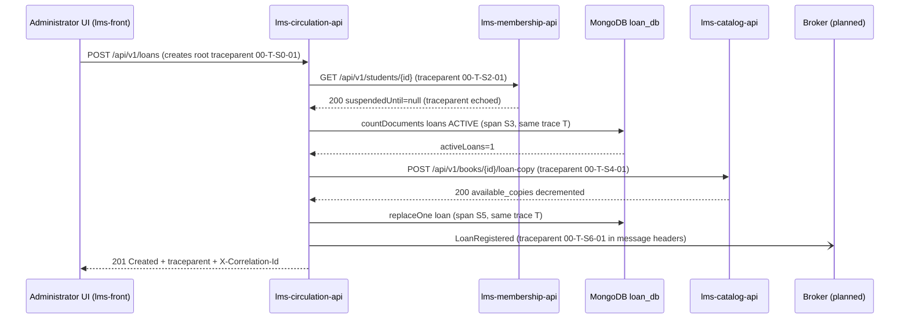

# CP1 — Critical journey and trace map

## Chosen journey: HU-06 Loan Registration

The Administrator registers a loan of a book to a student (`POST /api/v1/loans`).
It is the core-domain flow of LMS-Library and the only one that crosses three bounded
contexts: Circulation checks the student in Membership, reserves a copy in Catalog and
persists the `Loan` aggregate in its own MongoDB. `POST /loans` is also listed as a
critical endpoint in `library-docs/04-requirements/non-functional.md` (NFR-001).

Sources: `library-docs/04-requirements/user-stories.md` (HU-06),
`09-microservices/service-catalog.md`, `09-microservices/event-catalog.md` and the code of
`lms-circulation-api` (`LoanRegistrationService.RegisterLoan`).

## Hop table

| Step | Caller | Receiver | Protocol | Operation | Sync/Async | Data |
|---|---|---|---|---|---|---|
| 1 | Administrator browser (`lms-front` shell + circulation portal) | `lms-circulation-api` :8083 | REST | `POST /api/v1/loans` with `Idempotency-Key` | sync | none |
| 2 | `lms-circulation-api` | `lms-membership-api` :8081 | REST | `GET /api/v1/students/{id}` (eligibility, INV-003) | sync | `membership_db` students |
| 3 | `lms-circulation-api` | MongoDB `loan_db` | Mongo wire | `countDocuments` on `loans` where `status=ACTIVE` (INV-004, max 2) | sync | `loan_db.loans` |
| 4 | `lms-circulation-api` | `lms-catalog-api` :8082 | REST | `POST /api/v1/books/{id}/loan-copy` (decrement `available_copies`) | sync | `catalog_db` table `catalog.book` |
| 5 | `lms-circulation-api` | MongoDB `loan_db` | Mongo wire | `replaceOne` (upsert) of the `Loan` + idempotency key | sync | `loan_db.loans` |
| 6 | `lms-circulation-api` | message broker (planned) | AMQP (planned) | publish `LoanRegistered` on `circulation.loan.registered` | async | queue |

Notes:

- `lms-api-gateway` exists as a repository but is not implemented yet, so today step 1
  reaches `lms-circulation-api` through the portal dev proxy. Once the gateway exists it
  adds one hop that must forward `traceparent` untouched.
- Step 6 is **modeled, not wired**: the event catalog defines `LoanRegistered` but the
  project has no broker yet. It is mapped here so the async boundary is designed before
  it is built.
- **Critical hop: step 4.** `loan-copy` is the only call that changes another service's
  state, and the `catalogclient` waits up to 5 s. This is the dependency used in the CP9
  incident drill.

## Sequence diagram with trace context

`T` is the 32-hex `trace_id`, identical on every arrow. `S0..S6` are the 16-hex parent
span ids each caller writes into the W3C header `traceparent: 00-<trace_id>-<span_id>-01`.
`X-Correlation-Id` (already handled by the `CorrelationID` middleware of the three Go
services) keeps travelling next to it as the business-level id.

## Span tree

- `POST /api/v1/loans` — root span, `lms-circulation-api` (server), trace `T`
  - `RegisterLoan` — internal span (use case, idempotency check)
    - `GET /api/v1/students/{id}` — client span in `lms-circulation-api`
      - `GET /api/v1/students/{id}` — server span in `lms-membership-api`
        - `SELECT student` — db span on `membership_db`
    - `loans.countDocuments` — db span on `loan_db.loans`
    - `POST /api/v1/books/{id}/loan-copy` — client span in `lms-circulation-api`
      - `POST /api/v1/books/{id}/loan-copy` — server span in `lms-catalog-api`
        - `UPDATE catalog.book` — db span on `catalog_db`
    - `loans.replaceOne` — db span on `loan_db.loans`
    - `publish LoanRegistered` — producer span (async boundary, planned)
      - `consume LoanRegistered` — consumer span in a future subscriber, **same trace `T`**,
        linked through the `traceparent` header of the message

## Gap found while mapping

Today the trace breaks at steps 2 and 4: `lms-circulation-api` reads `X-Correlation-Id`
on the way in, but `membershipclient` and `catalogclient` only send `Authorization`.
Neither the correlation id nor a `traceparent` reaches the downstream services, so their
logs cannot be joined with the Circulation logs. CP3 fixes this for step 4.
