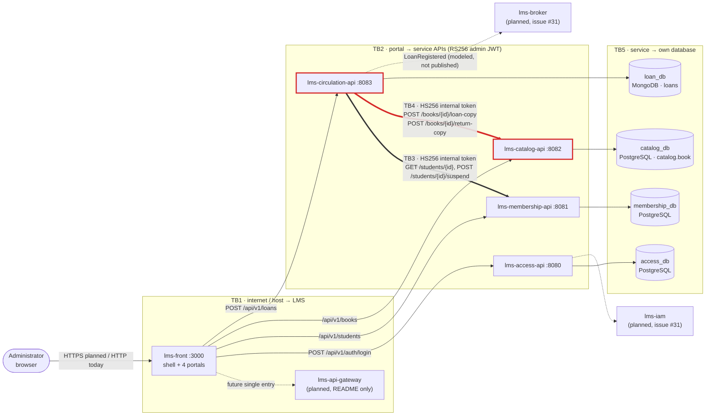

# CP1 — Attack surface and trust boundaries of LMS-Library

Sources: `library-docs` (`03-product/vision.md`, `05-architecture/overview.md` §7,
`09-microservices/service-catalog.md`, issue #31) and the `develop` branch of
`lms-circulation-api` and `lms-catalog-api`. My boundary is **TB4** (claim: issue #34).

## Data flow diagram

## Trust boundaries

| ID | Boundary | Crossed by | Owner in W13 |
|---|---|---|---|
| TB1 | Internet / docker host → LMS | the Administrator browser, and anybody who reaches a published container port | — |
| TB2 | Portal → service APIs | Administrator RS256 JWT issued by `lms-access-api` | — |
| TB3 | `lms-circulation-api` → `lms-membership-api` | HS256 internal token | @Hermesss29 (#33) |
| **TB4** | **`lms-circulation-api` → `lms-catalog-api`** | **HS256 internal token, HU-06 `loan-copy` and HU-07 `return-copy`** | **@MENESESLUIS-bot (#34)** |
| TB5 | Each service → its own database | DB user and password from env vars | — |
| TB6 | Service → `lms-broker` (planned) | not built yet (`AT-002`) | — |

There is no external API: LMS-Library only talks to its own services and databases.

## Asset inventory (Catalog / Circulation domain)

| Asset | Where it lives | Classification | Why |
|---|---|---|---|
| `available_copies` / `total_copies` of a `Book` | `catalog_db`, table `catalog.book` | internal (integrity-critical) | decides if a student can borrow; a wrong value blocks or allows loans at the desk |
| `Loan` aggregate (`studentId`, `bookId`, `dueDate`, `status`) | `loan_db`, collection `loans` | confidential | links a person to what they read |
| `INTERNAL_JWT_SECRET` | env var of `lms-circulation-api`, `lms-catalog-api`, `lms-membership-api` | restricted | whoever has it can mint a token accepted by all three services |
| Internal service token (`sub: circulation-service`, 1 min) | `Authorization` header on TB3/TB4 | restricted | bearer credential, valid on every route of `lms-catalog-api` |
| Administrator RS256 JWT | browser, `Authorization` header on TB2 | restricted | full Administrator session for 1 h |
| `catalog_db` credentials (`DB_USER`, `DB_PASSWORD`) | env var of `lms-catalog-api` | restricted | direct write access to `catalog.book` |
| Book metadata (`title`, `author`, `isbn`, `category`, `year`) | `catalog.book` | public | same data as the library shelf |
| `JWT_PUBLIC_KEY` | env var of every service | public | only verifies signatures |

## Entry points of TB4

| Entry point | Port | Called by | Authentication today | Effect |
|---|---|---|---|---|
| `POST /api/v1/books/{id}/loan-copy` | container 8080, published on the host as `${PORT}` (8082 locally) | `catalogclient.LoanCopy` in `lms-circulation-api` (HU-06) | `Authorization: Bearer` HS256 signed with `INTERNAL_JWT_SECRET`, claims `sub`, `iat`, `exp` (+1 min); no `aud`, no scope, no `jti` | `Book.LoanOneCopy()`: `available_copies - 1`, 422 `NO_COPIES_AVAILABLE` at 0 |
| `POST /api/v1/books/{id}/return-copy` | same | `catalogclient.ReturnCopy` (HU-07) | same | `Book.ReturnOneCopy()`: `available_copies + 1` up to `total_copies` |
| `PATCH /api/v1/books/{id}`, `DELETE /api/v1/books/{id}` | same | meant for the catalog portal only | the same `RequireAuth` group also accepts the internal HS256 token | edit or delete a book |
| `GET /health`, `GET /health/ready` | same | compose / monitoring | none | readiness exposes DB connectivity |

Observations that feed CP2:

- Transport is plain HTTP on `lms-network` (`CATALOG_SERVICE_URL=http://...`), no mTLS.
- `RequireAuth` accepts **either** algorithm on **every** route: no per-route scope, so the
  internal token can call `DELETE /books/{id}` and an Administrator token can call
  `loan-copy` directly, skipping the HU-06 rules of `lms-circulation-api`.
- Both `.env.example` files ship `INTERNAL_JWT_SECRET=change-me-internal-secret`.
- `loan-copy` has no `Idempotency-Key` and the use case is read-modify-write with an
  `INSERT ... ON CONFLICT DO UPDATE`, without a row lock.
