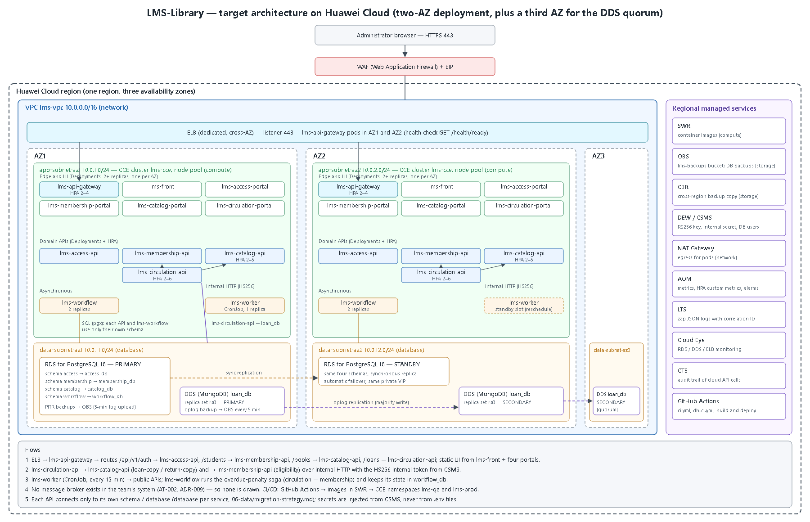

# Architecture design note — LMS-Library

## 1. Target architecture

Today LMS-Library runs as one Docker Compose stack on a single host (`05-architecture/deployment.md`). If that host goes down, the whole library desk stops. The target design moves the same services to Huawei Cloud in one region. Stateless containers run on a CCE cluster with node pools in AZ1 and AZ2. The PostgreSQL schemas move to an RDS primary/standby pair across those two AZs, and `loan_db` moves to a DDS replica set whose third node sits in AZ3 so that elections always have a majority. The team has no message broker (AT-002, ADR-009), so the diagram does not draw one.

A request follows this path. The Administrator's browser reaches the WAF and the EIP. A dedicated ELB then sends it to an `lms-api-gateway` pod in either AZ, and the gateway routes by path prefix to the owning API, as `ADR-003` already defines for NGINX. Only the ELB has a public address. The CCE nodes sit in private app subnets, and the databases in private data subnets that accept traffic only from the app subnets on ports 5432 and 8635. Pods reach the Internet, for example to pull base images, through a NAT Gateway. This keeps the rule from `05-architecture/deployment.md` that only the proxy is exposed, but now an AZ can fail without taking the desk down.

| Component in the diagram | Defined in (file of your team's -docs) |
|---|---|
| `lms-api-gateway` (CCE Deployment behind ELB) | `05-architecture/overview.md` (§4 service catalog), `05-architecture/decisions/records/ADR-003-nginx-reverse-proxy.md` |
| `lms-front` (Module Federation shell) | `05-architecture/overview.md` (§3, §4) |
| `lms-access-portal`, `lms-membership-portal`, `lms-catalog-portal`, `lms-circulation-portal` | `09-microservices/repo-migration-map.md` |
| `lms-access-api` | `05-architecture/overview.md` (§4), `07-api/contracts/openapi/access-service.yaml` |
| `lms-membership-api` | `05-architecture/overview.md` (§4), `07-api/contracts/openapi/membership-service.yaml` |
| `lms-catalog-api` | `05-architecture/overview.md` (§4) |
| `lms-circulation-api` | `05-architecture/overview.md` (§4), `05-architecture/decisions/records/ADR-005-mongodb-for-circulation-service.md` |
| `lms-workflow` and `workflow_db` | `05-architecture/decisions/records/ADR-008-circulation-saga-scope.md` |
| `lms-worker` (CronJob, every 15 min) | `05-architecture/decisions/records/ADR-009-worker-scheduling-model.md` |
| `access_db`, `membership_db`, `catalog_db` (RDS for PostgreSQL, one schema each) | `06-data/models.md`, `06-data/migration-strategy.md` |
| `loan_db` (DDS replica set) | `06-data/models.md`, `05-architecture/decisions/records/ADR-005-mongodb-for-circulation-service.md` |
| No broker (synchronous HTTP plus polling) | `05-architecture/overview.md` (§8, AT-002) |
| ELB, VPC subnets, WAF | `05-architecture/deployment.md` (§3 network rules that the cloud network replaces) |

## 2. Five principles

| Principle | Current weakness | Evidence in -docs | Design decision | Huawei Cloud service |
|---|---|---|---|---|
| Reliability | Everything runs on one Docker host. `lms-circulation-api` calls `lms-catalog-api` and `lms-membership-api` with no timeout, retry or breaker, so one slow service stops `POST /api/v1/loans`. | `05-architecture/overview.md` (P3, AT-002) | At least two replicas of every API, one per AZ, with pod anti-affinity. A 2 s timeout and 2 retries on the internal calls, which reuse the `Idempotency-Key` of the original loan request. RDS and DDS fail over automatically across AZs. | CCE, ELB, RDS for PostgreSQL (primary/standby), DDS replica set |
| Security | Both `.env.example` files ship `change-me-internal-secret`, and `RequireAuth` has no per-route scope, so a leaked internal token can delete books. | `05-architecture/security/stride-MENESESLUIS-bot.md` (rows S and E) | All secrets (RS256 private key, `INTERNAL_JWT_SECRET`, one DB password per domain) live in CSMS and reach the pods as Kubernetes secrets. Services refuse to start with the example value. WAF in front of the EIP, and databases only in private data subnets. | DEW / CSMS, WAF, VPC security groups |
| Performance efficiency | Scaling is manual and capped at the size of one 2 vCPU / 4 GB host, so the p95 under 300 ms target of `POST /loans` cannot be protected at peak hours. | `05-architecture/deployment.md` (§5) | HPA per Deployment on CPU or request rate (section 3). The CCE cluster autoscaler adds nodes, and ELB spreads load across both AZs. | CCE (HPA + cluster autoscaler), AOM custom metrics, ELB |
| Cost | The docs require "its own database instance" per domain. On a managed cloud that means four or five HA database pairs for a few thousand rows. | `06-data/migration-strategy.md` (schema ownership table) | One RDS for PostgreSQL HA pair with one schema and one login user per domain (`access`, `membership`, `catalog`, `workflow`). The qa namespace runs on one small pay-per-use node that is stopped at night. See ADR-C3-01. | RDS for PostgreSQL, CCE pay-per-use node pool |
| Operations | Distributed tracing is "not required in v1" and there are no alerts, so a failed loan cannot be followed across Circulation → Catalog. | `05-architecture/cross-cutting.md` (distributed tracing) | Ship the zap JSON logs with `X-Correlation-Id` to LTS. Scrape `/metrics` into AOM and raise alarms when the p95 of `POST /loans` is above 300 ms for 5 min or an RDS/DDS failover happens. CTS keeps the audit trail. | LTS, AOM, Cloud Eye, CTS |

## 3. Scalability

All APIs are stateless (NFR-003), so they scale horizontally. Every HPA starts with 2 replicas, one per AZ, so losing one AZ never drops a service to zero.

| Service | Scaling metric | Threshold (number and unit) | Min instances | Max instances |
|---|---|---|---|---|
| `lms-circulation-api` | Average CPU use per pod | 70 % of the CPU request (250 m) | 2 | 6 |
| `lms-catalog-api` | HTTP requests per second per pod (AOM custom metric) | 40 req/s | 2 | 5 |
| `lms-api-gateway` | Active connections per pod | 400 connections | 2 | 4 |

`lms-circulation-api` gets the highest ceiling because every loan and return goes through it, and on top of that it calls Catalog and Membership. Opening day of the semester at the desk is its real peak. `lms-catalog-api` scales on request rate instead of CPU because search requests are short and wait on I/O, so CPU rises too late. `lms-worker` is not scaled on purpose. It is a single CronJob replica, because a second replica would only repeat the same 15-minute tick (ADR-009). The node pool scales from 2 to 4 nodes, one minimum per AZ.

## 4. Disaster recovery

- Critical data store: `loan_db` (DDS, MongoDB), the only copy of active loans, due dates and return state. Catalog counts and suspensions can be rebuilt from it, but nothing can rebuild it.
- RTO: 15 minutes
- RPO: 5 minutes
- DR pattern (chapter 11): same-city (cross-AZ) active-standby, with a three-node DDS replica set over AZ1, AZ2 and AZ3, plus point-in-time recovery from incremental backups stored in OBS and copied to a second region with CBR.
- Why the pattern meets those numbers: if one AZ fails, the two nodes left still form a majority and elect a new primary in less than one minute, and since `lms-circulation-api` writes with `writeConcern: majority`, every confirmed loan is already in two AZs, so the data loss is 0 minutes and the downtime is well under 15. If the data is damaged by a bad release, replication copies the damage, so the recovery uses the oplog backups that DDS uploads every 5 minutes: a point-in-time restore of a small `loan_db` (thousands of documents) into a new instance plus a CSMS update of the connection string takes about 10 minutes, which keeps the loss at most 5 minutes and the downtime under 15.

The current target in `04-requirements/non-functional.md` (NFR-008) is a daily backup with RPO ≤ 24 hours. A daily backup can never meet a 5-minute RPO, so this design replaces it for `loan_db`.

The numbers are only worth something if they are tested. Before each release on `main`, the team runs one drill in `lms-qa` (the chaos testing of week 15). It stops the DDS primary node and measures the time until `POST /api/v1/loans` answers `201` again. Then it restores a backup from 5 minutes earlier into a new instance and times the full switch. If either drill goes over 15 minutes, the release is blocked until the runbook is fixed. The other schemas (`access`, `membership`, `catalog`, `workflow`) use the same idea on RDS: synchronous standby in AZ2 and log backups every 5 minutes.

## 5. Automated deployment

The team keeps GitHub Actions and the branch model of `00-governance/branching-policy.md` (`develop` → `qa` → `main`, with cherry-picks and teacher approval on `main`). Images go to SWR and run on CCE. Example paths are for Catalog. Every other `-api` and `-db` repository has the same files.

| Stage | Trigger | Tool or service | File in your team's repositories |
|---|---|---|---|
| Build | Pull request to `develop`, `qa` or `main` | GitHub Actions: `gofmt`, `go vet`, `go build` | `lms-catalog-api/.github/workflows/ci.yml` |
| Test | Same pull request | GitHub Actions: `go test ./...`; Liquibase update → update (no-op) → rollback → update on an empty PostgreSQL | `lms-catalog-api/.github/workflows/ci.yml`, `lms-catalog-db/.github/workflows/db-ci.yml` |
| Image | Merge into `develop` | Multi-stage Docker build (Go 1.25 → alpine 3.21), tagged with the commit SHA and pushed to SWR | `lms-catalog-api/deploy/Dockerfile` |
| Deploy to qa | Merge of a `qa/` branch into `qa` | Liquibase executor runs first against the `catalog` schema, then a CCE rolling update in namespace `lms-qa` | `lms-catalog-db/deploy/compose.yml` |
| Deploy to production | Merge of `release/x.y.z` into `main` after approval by `ariel5253` | GitHub environment `production` with manual approval. The image is promoted by digest from SWR (never rebuilt) and rolled out on CCE with `maxUnavailable: 0` | `lms-catalog-api/deploy/compose.yml` |
| Rollback | ELB health check or AOM alarm fails within 10 min of a release | `kubectl rollout undo` to the previous image digest; Liquibase `rollback` to the last tag for schema changes | `lms-catalog-db/changelog/changelog-master.yaml` |

The build, test and image files above already exist. The deploy steps reuse what the `deploy/compose.yml` files define today (image, port, variables, health check), translated into CCE manifests. The rollback is safe because the expand/contract rule in `06-data/migration-strategy.md` keeps the previous image compatible with the new schema.

The pipeline never holds database passwords or JWT keys in the repository. GitHub Actions only gets a short-lived IAM credential for SWR and CCE, and the pods read their secrets from CSMS at start-up. The security workflow proposed in week 13 (`gitleaks`, `govulncheck` and negative authorization tests) runs in the Test stage before any image is built.

## 6. Decisions

- [ADR-C3-01](ADR-C3-01.md): one RDS for PostgreSQL HA instance with a schema and a login user per domain, instead of one database instance per domain (section 2, Cost).
- [ADR-C3-02](ADR-C3-02.md): `loan_db` on a three-AZ DDS replica set with majority writes and 5-minute point-in-time backups (section 4, Disaster recovery).
